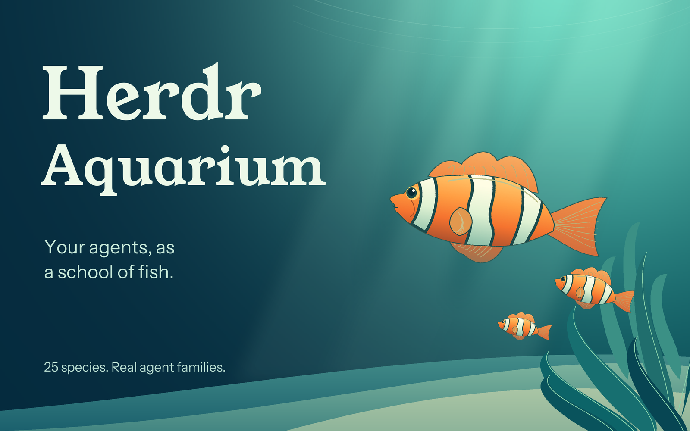

# Herdr Aquarium

Your coding agents, as a school of fish. Two native [Herdr GUI](https://herdr.dev) layouts: a practical workspace and a quiet, immersive tank. Both preserve the standard left sidebar.

> **Draft interaction work:** tracked in [#7](https://github.com/ZaneH/herdr-aquarium-theme/issues/7). The waypoint replacement for the [backwards-facing bug (#1)](https://github.com/ZaneH/herdr-aquarium-theme/issues/1) still requires live acceptance and is not ready to merge. Passing geometry/render tests does not establish correct movement.



*Historical, color-graded native screenshot: cropped to the tank, midtones brightened, agent labels blurred for privacy. The surround and headings are presentation, not app UI; no fish or controls were added. The current runtime has a newer, brighter habitat palette; a fresh sanitized native capture is pending.*

Regenerate from the preserved sanitized input with `uv run --with pillow==11.3.0 python tools/prepare-preview.py` (build-time only). See [gallery direction and provenance](docs/gallery-direction.md).

## Two modes

**Workspace** (`aquarium`): aquarium above your normal terminals. Tabs, splits, pane headers, Files/Changes, status bar, and shortcuts stay intact.

**Immersive** (`aquarium-immersive`): the tank fills the workspace beside the sidebar. Click a mapped agent fish to open its terminal at full workspace size. Raw background children instead open Herdr’s native terminal peek, without replacing the tank. **Back to aquarium** returns to the water without closing the agent. **Workspace / Immersive** buttons switch layouts.

```sh
herdr-app do layout.switch '{"name":"aquarium"}'
herdr-app do layout.switch '{"name":"aquarium-immersive"}'
# Original Herdr layout is untouched:
herdr-app do layout.switch '{"name":"main"}'
```

Hover a fish for status and location. The details strip follows the hovered agent, then the focused agent, then the first agent. Fish are also Tab stops with visible focus borders, accessible labels, and keyboard activation. In Free-floating mode each fish's generous click target and label move with it. Organized mode keeps stationary travel lanes; crowded schools wrap and scroll.

**Sub-agents become little fish in their parent's family.** Real `terminals().parent` relationships determine the groups, including nested descendants. Children inherit the main agent's species, with smaller portraits; deeper descendants are smaller again. Free-floating families drift as a group, keeping children alongside their parent. Organized families cluster beneath or alongside the parent depending on space. Each still has its own status, tooltip, Tab stop, and terminal click target. Missing/unmapped parents leave fish independent rather than guessing relationships. Families taller than the tank use separate scroll bands; multiple fitting families that each exceed half the tank in both dimensions also get separate bands so their targets cannot remain permanently overlapped. Narrow panes can scroll horizontally, and ordinary Free-floating routes can still cross.

## Options and motion

All **25 species** from [Polyy.AI's 2D Fish Sprites Pack](https://polyyai.itch.io/2d-fish-sprites-pack) are included. Species are deterministic by full terminal address; species can repeat.

There is no tank heading or toolbar full of settings: just the layout switch and **Options ▾**. The native dropdown uses switches and radio buttons, dismisses on outside press/Escape, and keeps settings together.

- **Animate aquarium:** opt-in; off on a fresh installation. Turning it off stops fish, bubbles, surface waves, attention bobbing, and shimmer.
- **Fish arrangement — Free-floating / Organized:** free-floating is the default. Families follow nearby deterministic waypoints with gentle course changes instead of a single left/right ping-pong loop. Organized preserves the original fixed lanes and 12-second routes for a more structured view.
- **Free-floating speed — Slow / Normal:** Slow is the default. Slow travels at up to about 12 px/sec in eight-second legs; Normal uses about 24 px/sec in six-second legs. Bounds can shorten a leg. Course changes are deterministic, without random darting. This setting affects Free-floating, not Organized's baked routes. Click targets move with the fish and stay comfortably larger than the artwork. Paths can cross: choose Organized for dense schools.
- **Turning — Smooth / Instant:** free-floating fish stop before reversing. Smooth briefly fades out, swaps directional sprites while invisible, then fades in before traveling; Instant swaps while stationary. Facing comes from the actual next waypoint, not a separate image clock. Organized retains source-angle turns.
- **Bubbles:** two original aerator streams rise along the sides. Paused mode uses still posters.
- **Surface waves:** a translucent surface ribbon slowly undulates across the top. Seamless fixed-size SVG tiles overscan both ends, so movement never exposes a shrinking image edge. Paused mode leaves it still.

All animation frames are native GPUI/image playback—not per-frame JavaScript. One cancellable view-level timer advances free-floating waypoints and stationary turn phases; native transitions draw the intervening frames.
Working and idle agents move when enabled. Blocked/done family leaders stop the whole family; descendants stay with their parent while retaining their own status cues. Blocked fish appear larger/closer to the glass, gently bob in a coral halo, and say **Needs you**. Done fish turn gold and show a brief three-second sparkle when first observed entering done with motion enabled; they stay gold until Herdr marks them seen/idle. The sparkle is native opacity animation, with one timer solely to remove it.
Preferences are shared by both modes and saved by Herdr. Motion is opt-in instead of detecting OS reduced-motion settings, which this API does not expose.

Optional command equivalents (when the aquarium is visible):

```sh
herdr-app do aquarium.motion
herdr-app do aquarium.turning
herdr-app do aquarium.bubbles
herdr-app do aquarium.water
herdr-app do aquarium.arrangement
herdr-app do aquarium.options
```

The source sheets are **camera rotations, not fin-flapping animation**. The result is traveling and turning fish, not simulated skeletal swimming. Gold is a lightweight baked PNG effect, not a live material shader. No speed slider, collision physics, or new dependencies in the running app.

### Telemetry limitation

Live status-reporting background child agents join their verified parent’s fish family even without a pane; clicking a raw-only child opens its native terminal peek in either layout, without assigning a pane or invented workspace scope. Shell/build subprocesses are not added, and surviving or unknown-parent children remain independent without invented workspace scope. Like Herdr’s native child list, raw child `done` displays as resting (not an unseen completion), and `error` as needing you.

The installed Herdr API does **not** document cache, context, model, or thinking telemetry. Cache and thinking show **not reported**. Nothing is inferred from agent status, fabricated, or scraped from terminal output/private session files. A future agent-side reporting integration can extend `mods/aquarium/model.js`.

## Could this use the 3D models?

The creator also offers a [3D Fish Pack](https://polyyai.itch.io/3d-fish-pack): 25 textured GLB models, plus a separate low-poly download (roughly 2,200–7,700 triangles per fish, versus 51,000–55,000 in the detailed set). The listing explicitly says these are **static meshes with no rig or animation**. They would need deformation or rigging for fin/tail swimming, not just movement through the tank.

Herdr GUI 0.1.15's installed mod API exposes 2D GPUI elements, paths, images, and native UI animation, but no documented GLB loader, 3D scene, or custom shader entry point. HTML/web views and Node APIs are explicitly unavailable to mods. A real-time 3D version therefore needs additional host support or a separate renderer/integration; dropping Three.js into this mod will not work.

The smallest next experiment is **offline side-view rendering** of a low-poly model with subtle deformation, lighting, and a turn, exported as transparent animation for the existing mod. That could improve depth without adding a running 3D engine. No 3D renderer, model rigging, or performance benchmark has been implemented; low triangle counts alone do not establish the cost of textures, transparency, or compositing.

## Install

Requires the **native Herdr GUI** with the layout/mod API described in its generated `~/.config/herdr-app/AGENTS.md`, not the older terminal Herdr plugins API.

Copy these paths into your Herdr app home (normally `~/.config/herdr-app`), **only if their destination names are unused**:

```text
layouts/aquarium.json
layouts/aquarium-immersive.json
themes/aquarium.json
mods/aquarium/
```

Then check the mod and select a layout. To update your own installation, copy the changed files after reviewing your local edits. Do not overwrite someone else's aquarium layout/mod. The theme picker can override the palette. Personal keys and settings are not changed. Shipped mods are referenced, never edited or vendored.

## Development and checks

```sh
node --test tests/*.test.mjs
uv run --with pillow python -m unittest discover -s tests
herdr-app check ~/.config/herdr-app/mods/aquarium
herdr-app status
herdr-app shot /tmp/aquarium.png
```

Node tests cover species/assets, missing telemetry, completion-entry detection, parent/descendant grouping, bounded geometry, full-width waves, heading versus displacement at both speeds/turn modes, stationary turns, pause/resize clamping, late callbacks, and scheduler cancellation/cleanup. Python checks verify organized routes and angles, all 25 static directional/gold sprite sets, bubble clips/posters, and seamless SVG tile geometry. Earlier native rendering and two-agent playback checks covered the previous movement implementation; they do not certify the new waypoint scheduler. The immersive terminal and return views previously rendered without app errors. The replacement still needs complete live movement/turn/pause/navigation checks. Full keyboard, empty/crowded UI, and every live status transition still need hands-on acceptance testing. No large-school CPU/GPU/memory benchmark yet; animated images use more decoded memory than their compressed file size. Pause motion for the lightest mode. All four statuses and nested fish families also pass an isolated native render check using test fixtures; actual live blocked/done transitions and agent-spawn lifecycles still need hands-on testing.

The repo's runtime assets total about 15 MB; the original 49 MB pack and build dependencies are not vendored. No runtime subprocesses, network requests, web views, per-frame JavaScript, or terminal scraping.

Regenerate the assets from the source pack ZIP:

```sh
uv run --with pillow python tools/prepare-fish.py /path/to/pack.zip
# Original bubble artwork needs no source pack:
uv run --with pillow python tools/prepare-bubbles.py
```

Pillow is build-time only. No further artwork is required. Optional next contributions: transparent plants/rocks/wood foreground art, or a reference image for a brighter tropical or more naturalistic treatment.

## License and credits

Code, documentation, and original habitat/atmosphere art (surface, halos, shimmer, bubbles): **MIT**, see [LICENSE](LICENSE).

Fish art: **[Polyy.AI — 2D Fish Sprites Pack](https://polyyai.itch.io/2d-fish-sprites-pack)**, supplied under a **CC0 1.0 public-domain dedication**. Cropped frames, recolored gold variants, and animated routes are derived from that pack. Its supplied terms are preserved verbatim at [mods/aquarium/assets/LICENSE.txt](mods/aquarium/assets/LICENSE.txt); the pack also states not to resell its unmodified files as your own asset pack. The MIT license does not replace those asset terms.

[RECIPE.md](RECIPE.md) describes the layout and behavior for a fresh native build.
