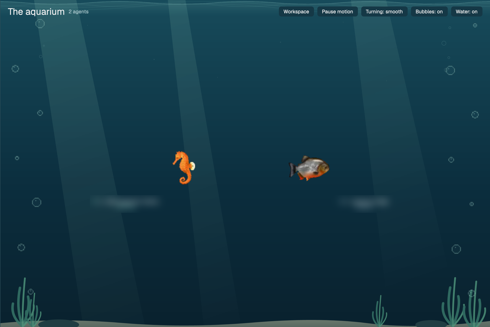

# Aquarium

Two calm native Herdr layouts: a working terminal workspace beneath an aquarium, and an immersive tank that fills the workspace. Live agents become fish; the standard left sidebar remains intact.

The screenshot is cropped to the tank, with agent labels blurred for privacy.

## What you see

Both layouts retain the shipped 268 px sidebar: spaces, agents, settings footer. Colors: deep water `#0a202b`, chrome `#102c38`, sea-glass `#9de0cf`, coral `#f2a394`, gold `#edd293`. UI and terminal fonts inherit personal settings.

Workspace: standard 42 px tabs; a 320 px aquarium block with a 58 px details strip; normal terminal pane cards and optional Files/Changes stack; 28 px status bar. Immersive: aquarium fills the area beside the sidebar, above the status bar. Opening a fish replaces that tank with a 42 px return/navigation bar and one full-size live agent terminal.

Aquariums show a heading/count and five controls: mode, motion, turning, bubbles, water. Fish travel in transparent, generously clickable lanes, distributed in a wrapping school. Real terminals().parent chains group agents into families; count families, not all individual fish, when choosing lanes. Leaders keep their own species; all descendants inherit it. Children use 60% portraits, deeper descendants 48%, with smaller local travel lanes. Each remains a separate clickable/tabbable fish with its own status. Show a small ↳ prefix on child labels and the family in tooltips; report the actual parent address in details. Immersive families stack parent above little fish; wide workspaces put the brood beside the parent. Missing/unmapped parents remain independent; guard parent traversal against cycles. Immersive mode uses up to two family columns and spreads rows vertically. Crowded schools scroll. Water has quiet light shafts, plants, bubbles, and sand, using a wide habitat SVG for workspace and a tall SVG for immersive.

## How it behaves

Working and idle fish travel when motion is enabled. Blocked fish stop traveling, grow from 108 px to 140 px (clamped in narrow lanes) to suggest approaching the glass, and gently bob 6 px in a pulsing coral halo; they say Needs you in coral. Done fish stop, turn gold, and say Finished. A newly observed completion gets three seconds of gold sparkles when motion is enabled; ordinary redraws do not replay it. Herdr changes done to idle when seen. Status text accompanies color.

Motion starts disabled; preferences persist across both modes. Bubbles and Water independently show/hide the aerator streams and surface ribbon, both on by default. Streams rise continuously along the sides and fade near the surface. The translucent wave ribbon undulates slowly across the top. Pausing the master motion control stops all fish, bubbles, surface movement, bobbing, and sparkles, leaving still art and status colors. Enabling it uses a native animated WebP: 12-second round trip, subtle vertical movement, a half-turn at either end. Smooth turning uses all 30 source angles; instant turning uses opposite broadside views. Species have phase offsets so the school does not turn together. Pause switches animated images back to still PNGs. No per-frame JavaScript or polling; one-shot completion expiry is the only effect timer.

Hover shows details and updates the strip. Otherwise it follows the focused agent or first agent. Cache/thinking say not reported because the documented interface does not expose them. Click focuses the real agent address; in immersive it also selects the terminal stack child. Back to aquarium selects the tank child without killing or parking the agent. Mode switches between aquarium and aquarium-immersive. Fish and controls are Tab stops with labels, activation, and visible focus borders. Empty schools direct users to Workspace's + menu.

## Built from

`layouts/aquarium.json` copies the shipped main tree and inserts aquarium after tabs. All stock mod references and IDs remain. `layouts/aquarium-immersive.json` keeps the sidebar and status, replacing work with stack aquarium-view: tank-view (aquarium mod, props immersive=true), terminal-view (aquarium navigation mod, props terminal=true; agent-focused terminal block).

One custom mod, aquarium. It reads agents, terminals, theme, shared, props, focused; writes shared keys aquarium.paused, aquarium.turning, aquarium.bubbles, aquarium.water; runs agent.focus, layout.select, layout.switch. A nextCommand listener supports aquarium.motion, aquarium.turning, aquarium.bubbles, aquarium.water. on_size_change measures the school only when geometry changes. Other agent-order behavior remains with Herdr's unchanged agents sidebar. No exec, fetch, arbitrary file reads, new shortcuts, or additional running processes.

Native surface animation loops the left position of surface.svg from -40 to 0 over 9 seconds. Blocked fish loop top 0–6 and halo opacity 0.5–1 over 3.2 seconds. Shimmer opacity loops 0.15–0.9 over 1.2 seconds; an address/status transition map starts it only on entering done, and a token-guarded cx.timer.after removes it after 3 seconds. A newer completion cannot be cleared by an older expiry callback. No timer draws animation frames. All these effects honor the master pause.

Original bubble art is generated by tools/prepare-bubbles.py: two transparent 64 × 384 WebPs, eight bubbles per stream, 180 frames at 50 ms (9-second loops), with slightly different phases, plus PNG posters for pause. These original assets and the surface/coral/gold SVG effects are MIT, not derived from the fish pack.

`model.js` implements species hashing, route geometry, asset selection, completion-entry detection, parent-chain family grouping, and honest details. `tools/prepare-fish.py` uses Pillow only at build time. All 25 Polyy.AI CC0 species get a still PNG, gold PNG, 30-angle swim WebP, and two-view glide WebP. Each animation is 512 × 128, 240 frames at 50 ms, with a 384 px travel distance before UI scaling. Eight-bit source silhouettes and alpha are retained through WebP encoding; rendered colors are lightly compressed. Original habitat SVGs are MIT, separate from the pack's preserved license.

## Watch out

- Native GPUI only, not HTML/CSS/Canvas. Installed AGENTS.md/type files are authoritative.
- Source frames are camera rotations, not swimming/fin poses. Species have different starting orientations; bass and angelfish need explicit broadside offsets.
- Animated WebP owns the whole travel lane. Its click target/label is stationary; it is not a moving fish-shaped hitbox. This intentionally makes agents easier to catch.
- Images load asynchronously; first-frame screenshots may lack art.
- Full workspace terminals use agent-focused composition blocks, not pane.zoom or destructive pane/layout restructuring. Implicit split/close commands do not work there; return to Workspace for pane manipulation.
- Missing telemetry must not be fabricated or obtained by scraping private agent files.
- Gold is baked, and glows/sparkles are SVGs with native opacity effects, not live shaders. Swimming has no speed slider, random wandering, collisions, or skeletal deformation.
- The separate 3D pack (https://polyyai.itch.io/3d-fish-pack) provides static, unrigged GLB meshes, including low-poly alternatives. This Herdr API has no documented 3D scene/model/shader hook and no web views. Do not assume it can host Three.js. Offline side-view renders are a possible future experiment, not part of this build.
- Species may repeat. Expanding the species table changes the hash mapping from earlier builds. Large schools wrap/scroll but are not virtualized; native animation's decoded memory cost exceeds file size. Motion is opt-in; benchmark real large-school demand before adding more complexity.
- Header controls wrap at narrow widths; very narrow windows may be cramped. Both layouts are primarily desktop views.
- Personal theme picks can override layout colors. Do not overwrite an existing destination on installation or edit shipped files.

## Done when

- Node helper tests and Python route/asset tests pass.
- Native mod check passes and app status has no errors in both layouts and immersive terminal view.
- Sidebar, tabs, split workspace, Files/Changes, and return to main remain available.
- Each real agent has a labeled fish; hover matches it, clicking opens the correct local/remote agent, Back returns to tank.
- Swimming plays natively, reverses direction, uses turn frames, pauses, and resumes; instant turns choose the two-view animation.
- Sub-agents inherit their leader's species at smaller sizes, cluster together, and each opens its own terminal. Nested, orphan, and cyclic parent data never loses fish or hangs the view.
- Bubbles rise and fade; Water moves the surface ribbon. Each can be hidden independently. Master pause stops all moving art.
- Blocked fish stop traveling and appear larger with a bobbing coral halo. Done fish are gold, sparkle briefly without replaying on a redraw, then remain gold. Paused mode keeps status cues without motion; empty/crowded layouts remain usable.
- Keyboard navigation/activation and visible focus work throughout.

Automated helper/asset checks, isolated native fixtures for all four statuses and nested families, and real two-agent native screenshots/playback have been verified. The immersive terminal and return views render. Full keyboard, empty/crowded UI, all status transitions, and a large-school performance benchmark remain hands-on acceptance work.
